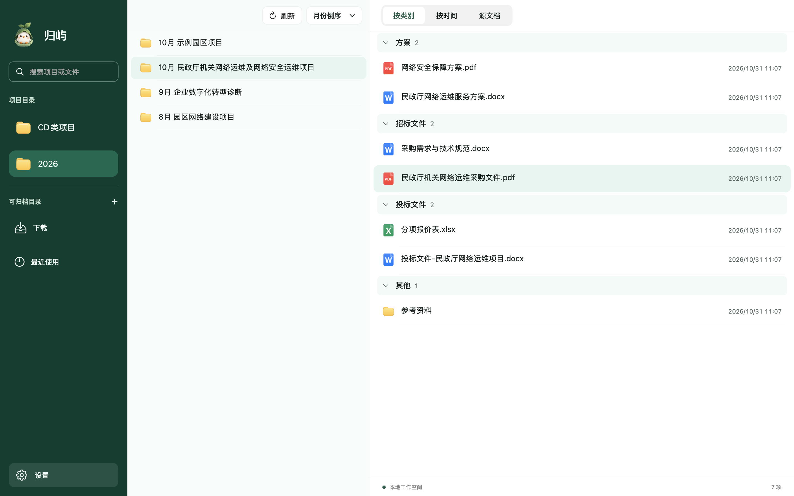

# 归屿 · 让每份文件都有归处

一款本地文件整理工具，帮助你给文件命名、归档和快速查找。支持 Mac 与 Windows，免费开源。

[下载安装](#下载安装) · [使用说明](docs/USAGE.md) · [更新日志](CHANGELOG.md) · [介绍视频](https://github.com/tiduse1988/guiyu/releases/download/v0.5.0/Guiyu-product-introduction.mp4)

## 核心功能

我懒懒懒，不想保存文件时候去选文件夹，我文件夹七八层，我的天。

我懒懒懒，不想保存文件时好好命名，我必须快速保存，后面命名归档一条龙

大白话版:
- 不想每次保存文件，一层层选文件夹路径？

  先随手保存到桌面或下载文件夹。之后用归屿“智能归档”，推荐对应项目，确认后移过去。

- 保存文件时，懒得复制标题当文件名，随便起个名字就存了？
  
  之后用归屿“智能命名”，识别文档里的标题，确认一下就能改好文件名。

  
官方描述～～～
- **智能命名**：读取文档标题，为文件和文件夹推荐名称，支持批量命名。
- **文字识别**：识别 PDF 和图片中的文字；Mac 版支持框选识别。
- **智能归档**：推荐目标项目，也可手动搜索选择；支持命名后继续归档。
- **分类与搜索**：按类别、时间或原始层级浏览，按名称搜索项目和文件。

沿用已有文件夹，本地处理，无需配置大模型 API。命名和归档均需确认，同名不覆盖。

## 下载安装

| 系统 | 已发布版本 | 安装包 |
| --- | --- | --- |
| macOS 13+ · Apple Silicon（M 系列） | 20261102(01) | [下载 DMG](https://github.com/tiduse1988/guiyu/releases/download/v20261102-01/Guiyu-20261102-01-macOS-arm64.dmg) |
| Windows 10 / 11 · 64 位 | 20261102(04) | [下载 EXE](https://github.com/tiduse1988/guiyu/releases/download/windows-20261102-04/Guiyu-20261102-04-Windows-x64-setup.exe) |
| Windows 10 · 32 位 | 20261102(04) | [下载 EXE](https://github.com/tiduse1988/guiyu/releases/download/windows-20261102-04/Guiyu-20261102-04-Windows-ia32-setup.exe) |

Mac 打开 DMG 后拖入“应用程序”；Windows 双击安装包。ZIP 解压版及历史版本见[全部发行版本](https://github.com/tiduse1988/guiyu/releases)。

Mac 首次打开若被系统拦截，确认官方来源后，到“系统设置 → 隐私与安全性”查看“仍要打开”。详细步骤见[使用说明](docs/USAGE.md)。

## 迭代记录

- [更新日志](CHANGELOG.md)：按 Mac、Windows 查看每版主要变化。
- [发行记录](https://github.com/tiduse1988/guiyu/releases)：完整发行说明、安装包及校验文件。
- [开发记录](https://github.com/tiduse1988/guiyu/commits/main/)：源码提交与开发进展。

[使用与构建说明](docs/USAGE.md) · [Windows 详细说明](Windows/README.md) · [MIT 许可证](LICENSE)
